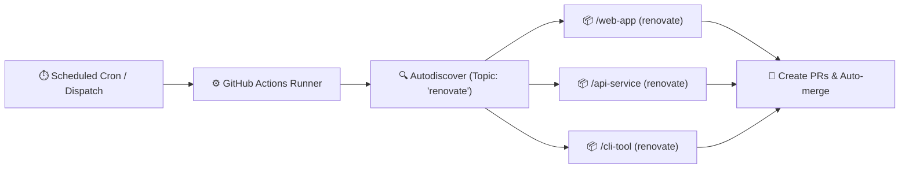

<div align="center">

# 🤖 Renovate Runner 🚀

_Centralized, self-hosted Renovate runner powered by GitHub Actions that dynamically discovers and updates repositories tagged with the `renovate` topic._

[](https://github.com/renovatebot/renovate)
[](LICENSE)
[](#-workflows--automation)

</div>

---

## 💡 Overview

This repository operates a centralized, self-hosted **[Renovate](https://docs.renovatebot.com/)** instance running on **GitHub Actions**.

Instead of running separate Renovate workflows inside every repository or manually maintaining a static repository list, this runner leverages Renovate's native **topic-based autodiscovery** (`autodiscoverTopics`).

Any repository owned by your account or organization that has the **`renovate`** topic applied will automatically be monitored and updated.



### Key Highlights

- **Zero-touch onboarding:** Tag any repo with the `renovate` topic, and Renovate automatically onboards it.
- **Shared config presets:** Host shareable Renovate presets (`default.json` and `automerge.json`) directly from this repository.
- **GitHub App authentication:** Automatically generate short-lived tokens per run, support downstream GitHub Actions triggers on Renovate PRs, and increase GitHub API limits to 15,000 req/hr.
- **Dynamic runner configuration:** Automatically detects your GitHub account/organization and repository name without needing hardcoded values.

---

## 🚀 Onboarding Guide (Fork to Running in 5 Minutes)

Follow these steps to fork this repository and set up automated dependency updates across your GitHub account or organization.

### Step 1: Fork the Repository

1. Click **Fork** at the top right of this repository to create a copy under your personal account or organization.
2. Navigate to the **Actions** tab in your newly forked repository.
3. Click **"I understand my workflows, go ahead and enable them"** (GitHub automatically disables Actions workflows on newly forked repositories).

---

### Step 2: Configure Authentication

Renovate requires GitHub credentials to discover repositories, inspect code, and open pull requests. You can authenticate using either a **GitHub App** (strongly recommended) or a **Personal Access Token (PAT)**.

#### Option A: GitHub App (Recommended)

GitHub Apps provide higher API rate limits (15,000 req/hr), enable downstream GitHub Actions to trigger on Renovate pull requests, and automatically attribute commits to your Renovate bot identity.

##### 1. Create the GitHub App
1. Go to **[Developer Settings → GitHub Apps → New GitHub App](https://github.com/settings/apps/new)**.
   *(If deploying for an organization, navigate to `https://github.com/organizations/<your-org>/settings/apps/new`).*
2. Fill in the basic details:
   - **GitHub App name:** `<your-org>-renovate` (or your preferred bot name).
   - **Homepage URL:** `https://github.com/<owner>/<repo>`
3. Under **Webhook**:
   - **Uncheck** "Active" (webhooks are not needed).
4. Under **Repository permissions**, grant:
   - `Contents`: **Read & write** *(to push update branches)*
   - `Pull requests`: **Read & write** *(to create and update PRs)*
   - `Issues`: **Read & write** *(to manage the Dependency Dashboard)*
   - `Workflows`: **Read & write** *(to update workflow files in `.github/workflows/`)*
   - `Metadata`: **Read-only** *(selected automatically)*
5. Under **Where can this GitHub App be installed?**, select **Only on this account**.
6. Click **Create GitHub App**.

##### 2. Generate Private Key & Note App ID
1. On the app's **General** settings page, copy the numeric **App ID** near the top.
2. Scroll down to the **Private keys** section, click **Generate a private key**, and save the downloaded `.pem` file.

##### 3. Install the App
1. From the app's left sidebar, click **Install App**.
2. Click **Install** next to your account or organization.
3. Choose **All repositories** (so any repo tagged with `renovate` is automatically accessible).
4. Click **Install**.

##### 4. Add Secrets to Your Runner Repository
In your forked runner repository, navigate to **Settings → Secrets and variables → Actions → Secrets** and add:

| Secret Name | Value |
|---|---|
| `APP_ID` | Numeric App ID from Step 2 |
| `APP_PRIVATE_KEY` | Full contents of the downloaded `.pem` file (including `BEGIN`/`END RSA PRIVATE KEY` lines) |

*(Tip: You can also set these secrets directly using the native GitHub CLI)*:
```bash
gh secret set APP_ID --repo <owner>/<repo> --body "<YOUR_APP_ID>"
gh secret set APP_PRIVATE_KEY --repo <owner>/<repo> < private-key.pem
```

---

#### Option B: Personal Access Token (PAT)

If you prefer using a Personal Access Token instead of a GitHub App:

1. Generate a Fine-grained PAT or Classic PAT with `repo` and `workflow` scopes.
2. In your runner repository, go to **Settings → Secrets and variables → Actions**.
3. Add a secret named `RENOVATE_TOKEN` (or `APP_TOKEN`) containing your token.

> [!NOTE]
> Pull requests created by a PAT with default permissions will not trigger downstream GitHub Actions workflows unless configured with specific credentials. A GitHub App is recommended to ensure your CI workflows run on Renovate PRs.

---

### Step 3: Tag Your Repositories

Any repository owned by your account/org that has the **`renovate`** topic applied will automatically be picked up by Renovate:

1. Navigate to any target repository you want Renovate to manage.
2. In the **About** section (top right of the repository homepage), click the ⚙️ gear icon.
3. Under **Topics**, add:
   ```
   renovate
   ```
4. Click **Save changes**.

Alternatively, tag repositories using the GitHub CLI:

```bash
gh repo edit <owner>/<target-repo> --add-topic renovate
```

---

### Step 4: Run Renovate & Verify

Run a dry-run test to verify that authentication works and your tagged repositories are discovered:

#### Via GitHub CLI:
```bash
# Trigger a full dry-run test
gh workflow run renovate.yaml --repo <owner>/<repo> -f dry_run=full

# Watch the run output
gh run watch --repo <owner>/<repo>
```

#### Via GitHub Web UI:
1. Go to the **Actions** tab in your runner repository.
2. Select the **renovate** workflow on the left.
3. Click **Run workflow**, choose `dry_run: full`, and click **Run workflow**.
4. Check the workflow run logs to verify Renovate discovered your tagged repositories.

Once the dry run succeeds, trigger the workflow with `dry_run: null` (default) or wait for the automatic scheduled run. Renovate will open a **`👷 configure renovate`** onboarding pull request on each discovered repository!

---

## 📦 Shared Configuration Presets

This repository serves as a **Shareable Config Preset** host. Repositories can reference these presets directly in their `.renovaterc.json5` or `renovate.json`:

```json5
{
  $schema: "https://docs.renovatebot.com/renovate-schema.json",
  extends: [
    "github><owner>/<repo>",
    "github><owner>/<repo>:automerge",
  ],
}
```

> [!IMPORTANT]
> **GitMoji by Default**: This repository is configured to **always use GitMoji** for all commit messages and pull request titles across both this runner and all onboarded downstream repositories:
> - **Onboarding Pull Requests:** Titled **`👷 configure renovate`** with commit message **`👷 configure renovate`**.
> - **Downstream Dependency Updates:** Formatted with [GitMoji](https://gitmoji.dev/) prefixes (`💥 `, `✨ `, `🐛 `, `📌 `, `👷 `, `🔒 `).
> - **Dependency Dashboard:** Maintained across all discovered downstream repositories as an issue titled **`Renovate Dashboard 🤖`**.
> - **Automatic Downstream Application:** Downstream repositories inherit these rules either globally via the runner's `globalExtends` or by extending `"github><owner>/<repo>"` in their configuration.

---

### 1. Default Preset (`default.json`)

**Reference:** `"extends": ["github><owner>/<repo>"]`

Features:
- Extends `config:recommended`, `docker:enableMajor`, and `helpers:pinGitHubActionDigests`.
- Enables the Dependency Dashboard (`Renovate Dashboard 🤖`).
- Uses Gitmoji commits by default (inlined semantic commit rules with GitMoji prefixes).
- Structured PR labels (`renovate/container`, `renovate/github-action`, `renovate/helm`, `renovate/mise`, `renovate/pre-commit`, `renovate/python`, etc.).
- Custom regex managers to detect dependencies annotated with `# renovate: datasource=... depName=...`.
- Support for `oci://` image strings.

### 2. Gitmoji Preset (`gitmoji.json`)

**Reference:** `"extends": ["github><owner>/<repo>:gitmoji"]`

Features:
- Semantic commits formatted with [GitMoji](https://gitmoji.dev/):
  - 💥 `major` updates (`semanticCommitType: "💥 "`)
  - ✨ `minor` updates (`semanticCommitType: "✨ "`)
  - 🐛 `patch` updates (`semanticCommitType: "🐛 "`)
  - 📌 `digest`, `pin`, `bump`, and `replacement` updates (`semanticCommitType: "📌 "`)
  - 👷 GitHub Actions updates (`semanticCommitType: "👷 "`, scope: `github-action`)
  - 🔒 Lockfile maintenance (`semanticCommitType: "🔒 "`)
- Formatted version tags `( {{currentVersion}} → {{newVersion}} )` and labels (`type/major`, `type/minor`, `type/patch`, `type/digest`).

### 3. Conventional Commits Preset (`conventional.json`)

**Reference:** `"extends": ["github><owner>/<repo>:conventional"]`

Features:
- Standard [Conventional Commits](https://www.conventionalcommits.org/) (no emojis):
  - `feat` for `major` and `minor` updates (`semanticCommitType: "feat"`)
  - `fix` for `patch` updates (`semanticCommitType: "fix"`)
  - `chore` for `digest`, `pin`, `bump`, `replacement`, and `lockFileMaintenance` (`semanticCommitType: "chore"`)
  - `ci` for GitHub Actions (`semanticCommitType: "ci"`, scope: `github-action`)
- Formatted version tags `( {{currentVersion}} → {{newVersion}} )` and standard type labels.

### 4. Safe Auto-merge Preset (`automerge.json`)

**Reference:** `"extends": ["github><owner>/<repo>:automerge"]`

Features:
- Automatically merges non-breaking (`minor`, `patch`, `digest`) updates for:
  - GitHub Actions
  - Pre-commit hooks
  - Mise tool configurations
- Requires a **3-day stability period** (`minimumReleaseAge: "3 days"`) and passing CI tests before merging.

---

## 🛠️ Changing & Customizing Settings

### 1. Switching the Entire Runner Globally to Conventional Commits
If you fork this repository and prefer Conventional Commits (`feat:`, `fix:`, `chore:`, etc. without emojis) across **all** your repositories:
1. In your runner repository, go to **Settings → Secrets and variables → Actions → Variables**.
2. Add or update the `RENOVATE_CONFIG_PRESET` variable:
   ```
   RENOVATE_CONFIG_PRESET = github><owner>/<repo>:conventional
   ```
3. The runner will automatically:
   - Create onboarding pull requests titled **`chore: configure renovate`**.
   - Set the onboarded repositories' `renovate.json` to extend `github><owner>/<repo>:conventional`.
   - Use standard Conventional Commits for all dependency updates.

### 2. Overriding Settings on an Individual Downstream Repository
If your runner uses the default GitMoji configuration, but an individual downstream repository requires different settings, you can override them in that repository's `renovate.json`:

<details open>
<summary><b>Option A: Use Conventional Commits on a Specific Repository</b></summary>

Extend `github><owner>/<repo>:conventional` after the default preset to override GitMoji rules:

```json5
{
  $schema: "https://docs.renovatebot.com/renovate-schema.json",
  extends: [
    "github><owner>/<repo>",
    "github><owner>/<repo>:conventional",
    "github><owner>/<repo>:automerge",
  ],
}
```

</details>

<details>
<summary><b>Option B: Disable Semantic Commits Completely on a Specific Repository</b></summary>

Extend `:semanticCommitsDisabled` to turn off all semantic prefixes:

```json5
{
  $schema: "https://docs.renovatebot.com/renovate-schema.json",
  extends: [
    "github><owner>/<repo>",
    ":semanticCommitsDisabled",
  ],
}
```

</details>

<details>
<summary><b>Option C: Custom Package Rules & Scopes on a Specific Repository</b></summary>

Add a custom `packageRules` block to override or add commit types, scopes, or schedules for specific dependencies:

```json5
{
  $schema: "https://docs.renovatebot.com/renovate-schema.json",
  extends: [
    "github><owner>/<repo>",
  ],
  packageRules: [
    {
      matchPackageNames: ["pytest"],
      semanticCommitType: "🧪 ",
      semanticCommitScope: "tests",
    },
  ],
}
```

</details>

### 3. Customizing Runner Presets Directly
You can also customize the presets directly in your runner repository:
- Edit [`default.json`](default.json) to adjust base managers, labels, or regex patterns.
- Edit [`gitmoji.json`](gitmoji.json) to customize GitMoji emojis or update types.
- Edit [`conventional.json`](conventional.json) to adjust Conventional Commit types.
- Edit [`automerge.json`](automerge.json) to tweak stability periods or add managers for automated merging.
- Any downstream repository extending `"github><owner>/<repo>"` automatically receives your updated rules on the next scheduled run.

---

## ⚙️ Configuration & Customization Options

### Repository Variables (`vars`)

Configure these under **Settings → Secrets and variables → Actions → Variables**:

| Variable | Description | Default |
|---|---|---|
| `RENOVATE_AUTODISCOVER_FILTER` | JSON array or pattern filtering discovered repositories | `["<github.repository_owner>/*"]` |
| `RENOVATE_AUTODISCOVER_TOPICS` | JSON array or topic string for target repositories | `["renovate"]` |
| `RENOVATE_CONFIG_PRESET` | Preset used in onboarding pull requests | `github><owner>/<repo>` |
| `RENOVATE_ONBOARDING_CONFIG_FILE_NAME` | Configuration file name created in onboarded repositories | `renovate.json` |
| `RENOVATE_SEMANTIC_COMMITS` | Semantic commit mode across all repositories (`enabled`, `auto`, `disabled`) | `enabled` |
| `RENOVATE_ONBOARDING_PR_TITLE` | Custom title for onboarding pull requests | `👷 configure renovate` |
| `RENOVATE_ONBOARDING_COMMIT_MESSAGE` | Custom commit message for onboarding commits | `👷 configure renovate` |
| `RENOVATE_GLOBAL_EXTENDS` | Presets extended across all discovered repositories | `["github><owner>/<repo>"]` |
| `RENOVATE_DEPENDENCY_DASHBOARD` | Enable Dependency Dashboard issue on all repositories (`true`/`false`) | `true` |
| `RENOVATE_DEPENDENCY_DASHBOARD_TITLE` | Issue title for the Dependency Dashboard | `Renovate Dashboard 🤖` |

> [!TIP]
> **Prettier & Pre-commit Compatibility**: The runner automatically formats onboarding configuration files (`renovate.json`) to adhere to Prettier's single-line array conventions so that CI checks and pre-commit hooks pass without modification. If you prefer using `.renovaterc.json5` or another file format for onboarding, set `RENOVATE_ONBOARDING_CONFIG_FILE_NAME` in repository variables.

### Repository Secrets (`secrets`)

Configure these under **Settings → Secrets and variables → Actions → Secrets**:

| Secret | Description | Required |
|---|---|---|
| `APP_ID` (or `RENOVATE_APP_ID`) | GitHub App ID | Recommended |
| `APP_PRIVATE_KEY` (or `RENOVATE_APP_PRIVATE_KEY`) | GitHub App RSA Private Key (`.pem`) | Recommended |
| `APP_TOKEN` / `RENOVATE_TOKEN` | Alternative Personal Access Token or external installation token | Optional |
| `DOCKER_USERNAME` / `DOCKER_TOKEN` | Docker Hub credentials to avoid Docker rate limits | Optional |

---

## 🚀 Workflows & Automation

### Automated Schedules & Triggers

The runner workflow (`.github/workflows/renovate.yaml`) runs:
- **On Schedule:** Every 30 minutes (`0/30 * * * *`).
- **On Push:** When updates are merged into `main` affecting runner configurations or presets.
- **Manual Dispatch:** On demand via GitHub Actions UI or `gh workflow run`.

### Manual Workflow Dispatch Options

| Input | Description | Default | Allowed Values |
|---|---|---|---|
| `repository` | Target a specific repo (e.g. `owner/repo`). Leave blank to discover all topic-tagged repos. | `""` | Any `owner/repo` string |
| `dry_run` | Test Renovate without opening or updating PRs | `null` | `null`, `extract`, `lookup`, `full` |
| `log_level` | Adjust logging verbosity | `info` | `trace`, `debug`, `info`, `warn`, `error` |
| `repo_cache` | Control repository cache reuse | `enabled` | `enabled`, `disabled`, `reset` |

---

## 🛠️ Repository Architecture

```
renovate/
├── .github/
│   ├── renovate-config.js      # Global Renovate runner configuration
│   └── workflows/
│       ├── renovate.yaml       # Main runner workflow (cron, push, manual dispatch)
│       └── validate.yaml       # CI validation (renovate-config-validator & actionlint)
├── default.json                # Shareable default preset ("github><owner>/<repo>")
├── gitmoji.json                # Shareable Gitmoji preset ("github><owner>/<repo>:gitmoji")
├── conventional.json           # Shareable Conventional Commits preset ("github><owner>/<repo>:conventional")
├── automerge.json              # Shareable automerge preset ("github><owner>/<repo>:automerge")
├── .renovaterc.json5           # Runner repo's self-renovating configuration
├── .pre-commit-config.yaml     # Pre-commit hooks for repo formatting and linting
└── LICENSE                     # MIT License
```

---

## 📄 License

This project is licensed under the [MIT License](LICENSE).
